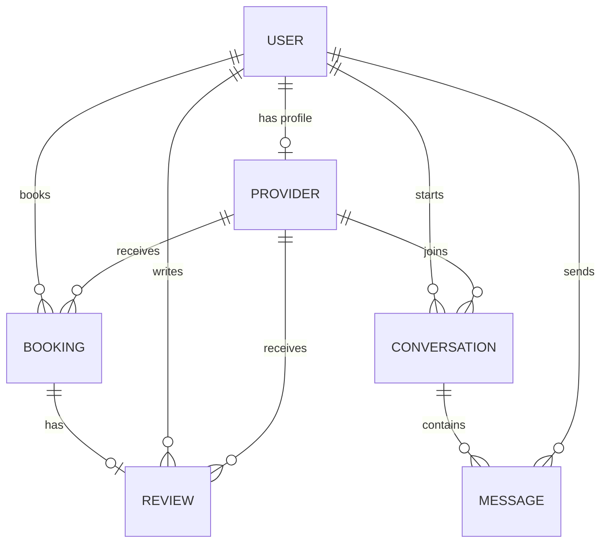

# Home Services API

REST backend for the Home Services Android app: find, compare and book trusted local
electricians, plumbers and appliance technicians.

## Tech stack
- Node.js, Express and TypeScript
- PostgreSQL with Prisma ORM
- JWT authentication with bcrypt password hashing
- Zod request validation
- Swagger / OpenAPI documentation
- Vitest and Supertest for automated tests

## Features
- Customer and provider accounts with role-based access
- Provider search by trade and keyword, with ratings and reviews
- Bookings with double-booking prevention and a controlled status flow
- Reviews that update a provider's rating, only after a completed job
- Private customer-provider chat (REST, supports polling)

## Getting started
1. Install PostgreSQL and create a database named `homeservices`.
2. Copy `.env.example` to `.env` and fill in your values.
3. Install and set up:

```bash
npm install
npx prisma migrate deploy
npm run seed      # optional: demo providers
npm run dev       # http://localhost:3000
```

API docs: http://localhost:3000/docs

## Scripts
| Command | Purpose |
|---|---|
| `npm run dev` | Start the server with auto-reload |
| `npm run build` / `npm start` | Compile and run for production |
| `npm run seed` | Add demo providers (password: `Password123`) |
| `npm test` | Run the automated tests (uses `homeservices_test`) |
| `npm run test:migrate` | Create the tables in the test database |

## API overview
| Area | Endpoints |
|---|---|
| Auth | `POST /auth/register`, `POST /auth/login`, `GET /me` |
| Providers | `GET /providers?trade=&q=`, `GET /providers/:id`, `GET /providers/:id/reviews` |
| Bookings | `POST /bookings`, `GET /bookings`, `GET /bookings/book-again`, `PATCH /bookings/:id/status` |
| Reviews | `POST /bookings/:id/reviews` |
| Chat | `POST /conversations`, `GET /conversations`, `GET/POST /conversations/:id/messages` |

Protected routes need the header `Authorization: Bearer <token>`.

## Booking rules
- Only customers can create bookings; the date cannot be in the past.
- A provider cannot be booked twice for the same date and time slot.
- Providers confirm or complete bookings; customers can only cancel.
- Allowed flow: `PENDING -> CONFIRMED -> COMPLETED`, and `PENDING` or `CONFIRMED -> CANCELLED`.

## Database design


## Security
- Passwords hashed with bcrypt; hashes are never returned by the API
- Signed JWTs with expiry; role checks on protected routes
- Request validation with Zod; consistent JSON error responses
- Helmet security headers and rate limiting on login and registration
- Users can only read their own bookings and conversations

## Project structure
```
src/
  app.ts, index.ts   app setup and server start
  modules/           auth, providers, bookings, reviews, chat
  middleware/        authentication, error handling
  docs/              OpenAPI specification
  lib/, utils/       Prisma client, helpers
prisma/              schema and migrations
tests/               automated API tests
```

## Testing
`npm test` runs 32 tests covering authentication, permissions, double-booking,
the booking status flow, review ratings and chat privacy. The tests run against a
separate `homeservices_test` database and refuse to run against any other.